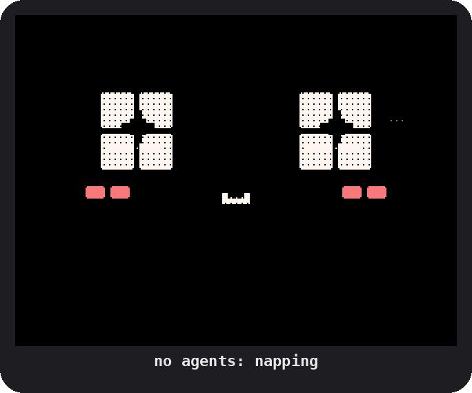
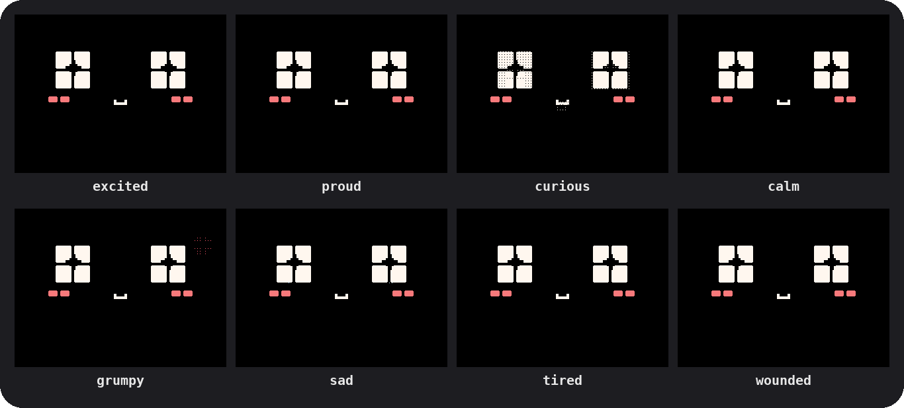
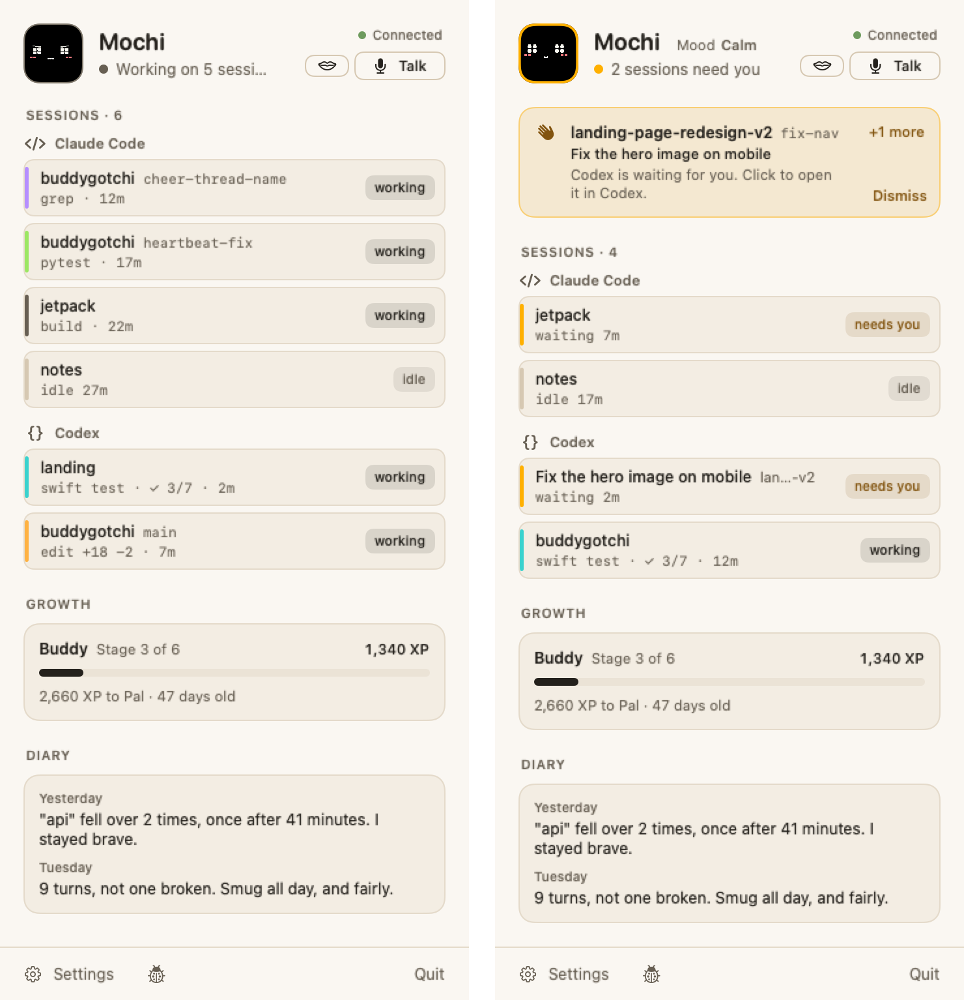

<p align="center">
  
</p>

<h1 align="center">PixelBuddy</h1>

<p align="center">
  <b>A pixel-art face for your desk that keeps an eye on your AI coding agents.</b>
</p>

<p align="center">
  
  
  
  
</p>

You've got three Claude sessions and two Codex threads going, and one of
them has been waiting on you for ten minutes. Pixel noticed, and it's
holding up a sign about it.

## Meet Pixel

Pixel is a chunky pixel-art face on the Cheap Yellow Display, the cheap
ESP32 board with a 2.4" screen. It's friendly, curious and a little
dramatic: it likes it when things go well, sulks a little when they
don't, and never blames you. Underneath it's cheeky. It grins at a win
as if it saw it coming, and huffs at a failure sooner than it sulks.

- 💤 **Naps** while no agent is open.
- ⌨️ **Works along** while they work: typing at the terminal, running
  tests, planning, searching, sending helpers off.
- 🟧 **Holds up an amber placard** when an agent needs your approval,
  and says who.
- 🏆 **Celebrates** a finish that earns it, and grumbles at a failed test
  (never at you).
- 👀 **Looks up** when you say its name in a prompt, as if it heard you.
- 👉 **Pokes back** when you tap it, and answers when you hold its button
  and talk.
- 📔 **Keeps a diary**, and dresses for the day: coffee in the morning,
  a hat on its milestone days, a costume on Halloween.

It has moods of its own and there's no reset button. It only watches:
it never approves, denies or blocks anything an agent does.

<p align="center">
  
</p>

A menu-bar app on your Mac does the thinking, and the board is its body:

<p align="center">
  <picture>
    <source media="(prefers-color-scheme: dark)" srcset="media/popover-dark.png">
    
  </picture>
</p>

> **Would you like a ready-made one?** The software is free and stays MIT.
> If you'd rather not flash a board yourself,
> [let us know →](https://tally.so/r/ZjprM5?src=pixelbuddy)

## Get started

### What you need

| You need | Why |
| --- | --- |
| 💻 **A Mac** | macOS 15 or later, with Command Line Tools 26 or later (`xcode-select --install`): Swift 6.2 and the macOS 26 SDK |
| 🐍 **A newer Python** | For flashing the board, unless you already have PlatformIO's `pio`: `brew install python`. PlatformIO installs itself |
| 🟨 **The board** | A Cheap Yellow Display, the MicroTech **MTR024QV01A-V1**: a 2.4" IPS screen, 320×240, with resistive touch. And a USB cable that carries data |
| 💾 **A microSD card** | Optional, for Pixel's voice: copy `character/voice/voice.bin` onto a FAT32 card as `boop/voice.bin`. Without one it's silent, and its faces and sounds work the same |
| 🔑 **A Jev key** | Optional. [Jev](https://docs.typesafe.ai/api) is TypeSafe's small hosted model, and it's what picks Pixel's reactions. Without a key, Pixel still shows what your agents are doing and when you're needed, but doesn't react or celebrate. Add it in Settings |

### Three steps

Clone this repository with its submodules, and run everything from its
folder:

```sh
git clone --recurse-submodules https://github.com/Mellow-Machines-Lab/PixelBuddy.git && cd PixelBuddy
```

1. **Flash it.** Plug the board in over USB and run `make flash`. The
   first time, it installs PlatformIO and the ESP32 toolchain, which
   takes a few minutes.
2. **Run it.** From your own terminal, run `make bundle`, then
   `open Boop.app`. The first build takes a few minutes, then Pixel says
   hello in a window of its own.
3. **Meet it.** It walks you through what it does, gets a name, finds
   its body on your desk (tap its screen when it asks), shows you how to
   use it, and connects your agents. Then it lives in the menu bar.
   Restart open agent sessions so they pick up its hooks.

Then tap the screen to poke it. Press BOOT while an agent waits for you
and it opens that agent on the Mac.

### Everyday commands

| To | Run |
| --- | --- |
| Flash the firmware (over USB) | `make flash` |
| Build `Boop.app`, to open from Finder or put in Applications | `make bundle` (then `open Boop.app`) |
| Play one of its demos in the simulator, in a browser, no board needed | `make demo` (it asks which; `NAME=hello` plays that one) |
| Work on it: the debug app, the simulator, the studio and the live dashboard | `make dev` |

Run `make bundle` and `make dev` from your own terminal: macOS stops
anything that uses Bluetooth from an editor's or an agent's shell.

## What leaves your Mac

Nothing, unless you add a Jev key. With one, Pixel sends TypeSafe a
short text each time it thinks: what's been happening, in lines like
`claude started turn 1 on "landing".`, and its personality and mood.
Your files, commands and tool output never go.
[Boop's README](https://github.com/Mellow-Machines-Lab/buddygotchi#what-leaves-your-mac)
has the whole list.

## Make your own character

Pixel is the example character: start from a copy of `character/`, its
character pack, and change who it is, how it looks and how it sounds.
[CHARACTER.md](https://github.com/Mellow-Machines-Lab/buddygotchi/blob/main/characters/CHARACTER.md)
says what goes in a pack, and how to make one.

| Folder | What it is |
| --- | --- |
| `character.json` | Its name and its moods, and how they connect |
| `steering/` | Who it is, for the brain: its personality, how it reads what happens, and how each mood acts |
| `design/boop-sound-bank-v4/` | The animation bank: every face and sound as code ([Pixel's design](character/design/README.md)) |
| `tools/facegen/`, `tools/sfxgen/` | Turn the bank into the firmware's faces and sounds (`make faces`) |
| `firmware/src/render/pixel/` | The pixel face's code, which draws it on the board and in the simulator |
| `voice/`, `mac/takes.tsv` | Its recorded voice and the Mac's table of it |
| `rig/`, `demo/`, `evals/`, `tests/` | Its moves, its demos, the brain's eval scenarios and its tests |

`engine/` is [Boop](https://github.com/Mellow-Machines-Lab/buddygotchi),
the engine every character runs on: the Mac app, the board's firmware,
the brain and the device link. `make check` runs all its checks with
Pixel.

## Other characters

- **[SlimeBuddy](https://github.com/Mellow-Machines-Lab/SlimeBuddy)**:
  a gel slime on a 2" AMOLED, Boop's own character.

## Licence

MIT, as Boop is ([LICENSE](LICENSE)). Its fonts and libraries are listed
in Boop's
[THIRD_PARTY_NOTICES.md](https://github.com/Mellow-Machines-Lab/buddygotchi/blob/main/THIRD_PARTY_NOTICES.md).
